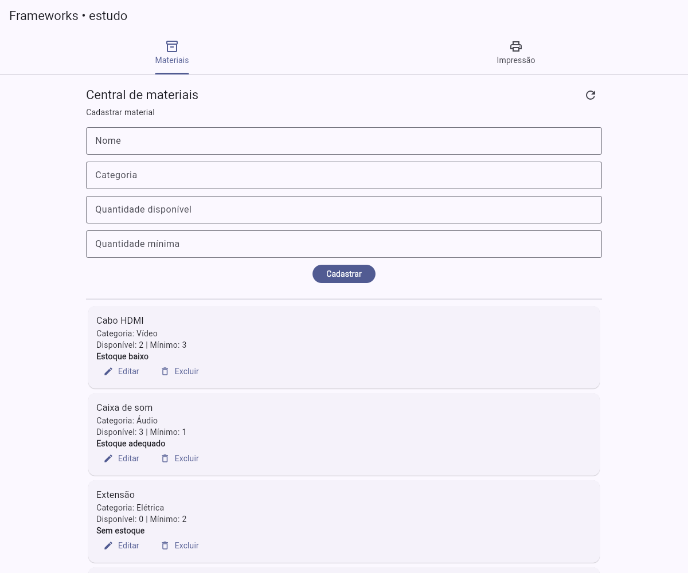
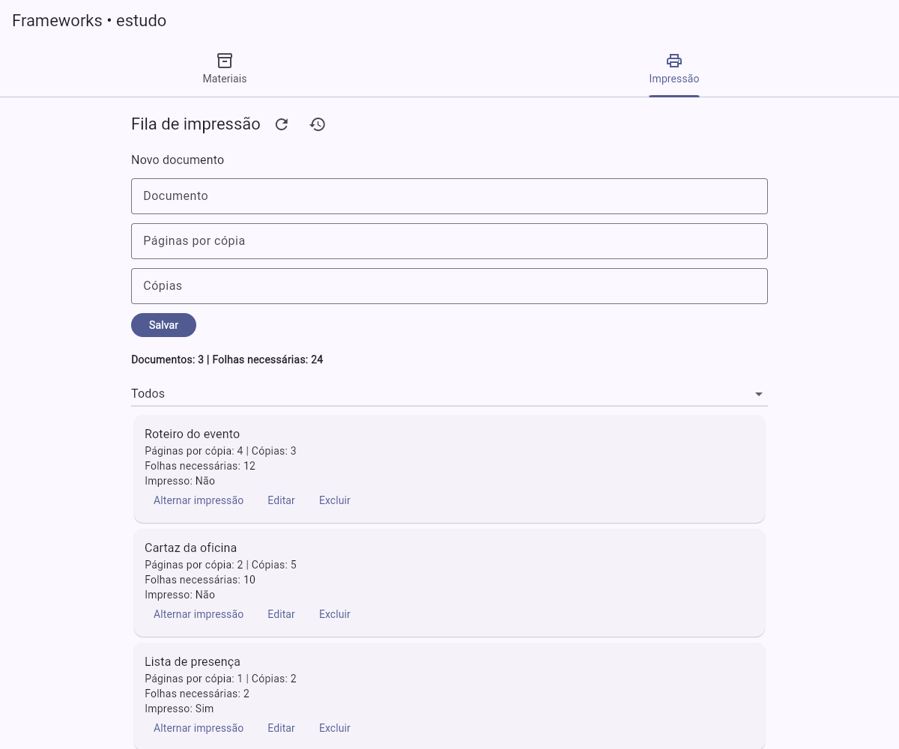
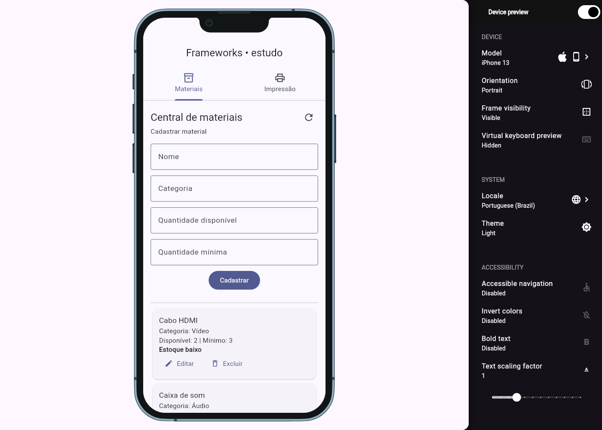

# Relatório de validação

Data: **17/11/2026**. Ambiente: Windows, Flutter **3.47.9 stable**, Dart **3.13.7**, Google Chrome **156**. O código comentado entregue foi analisado e testado neste ambiente. Os requisitos declarados no manifesto não substituem uma verificação em SDKs mais antigos.

## Verificações automáticas

```powershell
flutter pub get
flutter analyze
flutter test --reporter expanded
flutter build web --no-wasm-dry-run --no-web-resources-cdn
flutter build web --debug --no-wasm-dry-run --no-web-resources-cdn --output build/web_debug
```

Resultado: resolução de dependências concluída, análise sem apontamentos, **16 testes aprovados** e builds web release/debug gerados. Os arquivos de build são recriáveis e não integram o ZIP de fontes.

### Regras e SQLite — 12 testes

Arquivo: `test/regras_e_persistencia_test.dart`.

1. Texto obrigatório: null, vazio e espaços recusados; texto preenchido aceito.
2. Quantidades de materiais: zero aceito; negativos, decimais, letras e vazio recusados.
3. Estoque: zero/zero, zero com mínimo positivo, baixo, igualdade e acima do mínimo.
4. Duplicidade: acentos, caixa, espaços externos, próprio ID e nome de outro material.
5. ViewModel: validação sem Form, cadastro e notificação dos observadores.
6. Atualização e exclusão de materiais limitadas ao ID selecionado.
7. Fila por chegada; folhas 12/10/2; filtros e resumo global de 24.
8. Impressão: zero, negativos e conversões inválidas recusados.
9. Marcação individual e reversível, preservando os demais documentos.
10. Cadastro, edição e exclusão de documentos; edição preserva status impresso.
11. Restauração das amostras de documentos preserva a tabela de materiais.
12. Persistência em arquivo SQLite real: fechar/reabrir conserva inserções, edições, exclusões e marcações.

Os cenários usam o mesmo SQL do aplicativo. Não substituem os repositories por mocks que já devolvem o resultado esperado. O banco em memória isola os casos comuns; o último cenário usa arquivo físico temporário e o remove após o teste.

### Interface — 4 fluxos

Arquivo: `test/interface_test.dart`. Há um fluxo completo de Materiais e um de Impressão em cada dimensão lógica: **360×800** e **390×844**.

Os fluxos verificam preencher e salvar formulários, editar, alcançar ações por rolagem, cancelar e confirmar exclusão, preservar os outros IDs e não produzir overflow. A impressão também verifica abrir o seletor, escolher Pendentes e retornar para Todos, manter o total 24, cancelar restauração e confirmar restauração preservando materiais.

Esses testes simulam as páginas Flutter em tamanhos móveis. Não são execuções em aparelhos físicos.

## Conferência no Google Chrome

Foi usado um Chrome headless separado, sem acessar o perfil pessoal do usuário. Um servidor HTTP local serviu o build release. Foram verificados pela interface:

- Abertura das duas abas e carregamento de suas amostras no SQLite Web.
- Cadastro de `Teste navegador`, categoria `Estudo`, quantidade 0 e mínimo 0; situação Sem estoque.
- Recarga da mesma origem e recuperação desse material.
- Ordem Roteiro, Cartaz, Lista; folhas individuais 12, 10 e 2; resumo 3 documentos/24 folhas.
- Marcar Roteiro como impresso sem alterar Cartaz ou Lista.
- Recarregar e recuperar o status persistido de Roteiro.
- Selecionar Pendentes depois da marcação: aparece apenas Cartaz, mantendo o resumo global 24.
- Confirmar a restauração e recuperar as três amostras.

Não foram registrados erros JavaScript de página na execução final. O worker mantém comunicação assíncrona; a espera genérica por rede ociosa não foi usada como prova de que a interface estava pronta. As verificações aguardaram os campos e os resultados observáveis. Transições entre abas foram concluídas antes de interagir com o seletor.

O build debug foi aberto separadamente. A simulação do DevicePreview apareceu no Chrome, com o modelo iPhone 13 e a interface de Materiais carregada. As duas dimensões de conferência do layout foram cobertas pelos testes de widgets.







As capturas mostram dados de exemplo. O conteúdo abaixo da janela continua acessível por rolagem.

## Compatibilidade do worker SQLite

A conferência inicial no navegador identificou `unsupported result null (null)`. A causa foi a geração isolada do worker pelo setup de `sqflite_common_ffi_web 0.4.5+4`: ele resolveu `sqlite3 3.9.1` em seu projeto temporário enquanto baixou o WASM de `sqlite3-2.4.6`. O app usa `sqlite3 2.9.4`.

A versão entregue recompila a entrada do worker com o **lock do próprio aplicativo**:

```powershell
dart compile js -O2 --no-source-maps -o web/sqflite_sw.js tool/sqlite_worker.dart
```

O arquivo `tool/sqlite_worker.dart` apenas chama o mesmo ponto de entrada interno do pacote fixado. `web/sqlite3.wasm` e o worker compatível já acompanham o ZIP. Essa incompatibilidade de geração é um achado de ambiente desta preparação; não é apresentada como um dos cinco erros do exercício do professor.

O [README do pacote na versão usada](https://pub.dev/packages/sqflite_common_ffi_web/versions/0.4.5%2B4) explica a preparação WASM/worker e a vinculação da persistência à origem. Ao atualizar dependências, reavalie também a geração do worker e repita o teste no navegador.

## Alcance da validação

O alvo entregue é Flutter Web no Chrome. Não foram gerados nem testados aplicativos nativos Android/iOS, nem foi feita publicação no GitHub. Persistência pode ser separada ou removida ao mudar origem/perfil ou limpar armazenamento do navegador. O resultado corresponde à versão entregue e ao ambiente acima.
